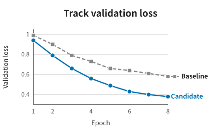
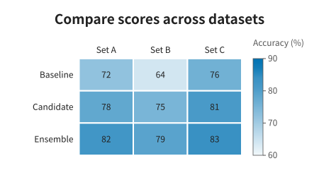
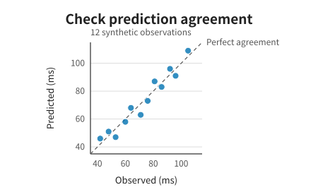
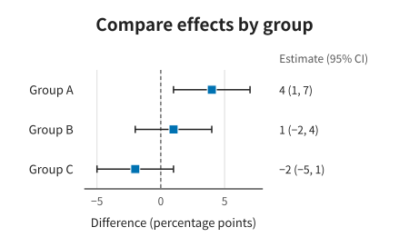
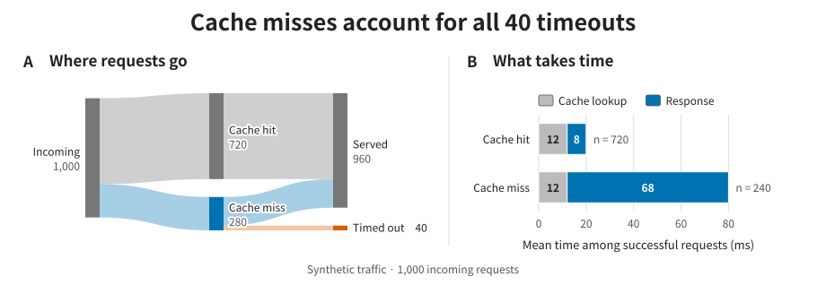

# zukai · 図解

**An Agent Skill for drawing and checking SVG diagrams and charts.** Use it to explain a workflow, show how a system fits together, or make the results of an experiment easier to read in a report, tutorial, or slide.

## Figure gallery

Select any figure to open its SVG. All plotted data are synthetic.

<table>
  <tr>
    <td width="50%">
      <strong>Workflow diagram</strong><br>
      <a href="examples/workflow.svg"></a><br>
      Follow the steps from choosing a question to writing the caption.
    </td>
    <td width="50%">
      <strong>Repeated measurements</strong><br>
      <a href="examples/comparison.svg"></a><br>
      Each dot is one run. Open circles and whiskers show the mean and one standard deviation on each side.
    </td>
  </tr>
  <tr>
    <td width="50%">
      <strong>Learning curves</strong><br>
      <a href="examples/learning-curve.svg"></a><br>
      Track each method across epochs using a shared axis.
    </td>
    <td width="50%">
      <strong>Heatmap</strong><br>
      <a href="examples/heatmap.svg"></a><br>
      Compare accuracy across datasets. The numbers give the exact values.
    </td>
  </tr>
  <tr>
    <td width="50%">
      <strong>Scatter plot</strong><br>
      <a href="examples/scatter.svg"></a><br>
      Each dot is a prediction and its observed value. The dashed diagonal shows perfect agreement.
    </td>
    <td width="50%">
      <strong>Forest plot</strong><br>
      <a href="examples/forest.svg"></a><br>
      The squares show estimated differences. Read the intervals against the dashed line at zero.
    </td>
  </tr>
</table>

### Worked example: trace requests through a cache

[](examples/request-routing.svg)

The widths of the Sankey flows show how the 1,000 requests split. All 40 timeouts follow a cache miss. Among successful requests, a miss takes 80 ms on average versus 20 ms for a hit. The stacked bars show the time spent on the cache lookup and the response that follows.

## Install

In your project directory, run the [skills CLI](https://github.com/vercel-labs/skills) and select your agent:

```sh
npx skills add yayuyosakana/zukai --skill zukai
```

You can also clone the repository and place the whole [`skills/zukai`](skills/zukai) folder in a skills directory your agent discovers. The scripts use Python 3.10+ and the standard library. The Markdown checker uses Git to find the repository root. PNG previews are optional and use Chrome, Chromium, or `rsvg-convert`.

## Try it

Ask your agent to use zukai and tell it where the figure will appear:

> Use zukai to add a diagram of the input → processing → evaluation flow to this README. Use the actual code to name each stage. Check the SVG at 720 px and add a caption.

> Use zukai to compare the two runs in `results.csv`. Show the observations for each condition, include the units, and label the summary interval.

> zukai を使って、この実験レポートに「何をしたか」の流れ図と「何が分かったか」の結果図を入れて。各図の下に、どこを見ればいいか一文で書いて。

## What gets checked

| At this step | What zukai looks for |
|---|---|
| Save a figure | Text that extends past its box, overlaps nearby labels, or falls outside the canvas |
| Check the SVG | Text size at its intended display width, contrast, line and text collisions, hard to distinguish series, and invalid SVG references |
| Check the Markdown | Missing local images, paths outside the repository, and missing captions |

These checks use approximate text bounds. Preview the figure if you need to confirm a particular font or layout. For uncertainty plots, compute intervals using your analysis and pass the endpoints and interval type to the drawing script.

## Run the examples without an agent

From a clone of this repository:

```sh
python3 examples/make_examples.py
python3 skills/zukai/scripts/check_svg.py examples/*.svg
python3 skills/zukai/scripts/check_md.py README.md
```

The [example script](examples/make_examples.py) recreates every figure in the gallery. For more figure types, see the [chart and diagram guide](skills/zukai/references/patterns.md). Agent instructions are in [SKILL.md](skills/zukai/SKILL.md).

## License

[MIT](LICENSE)
