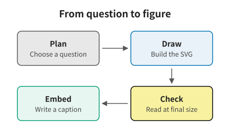
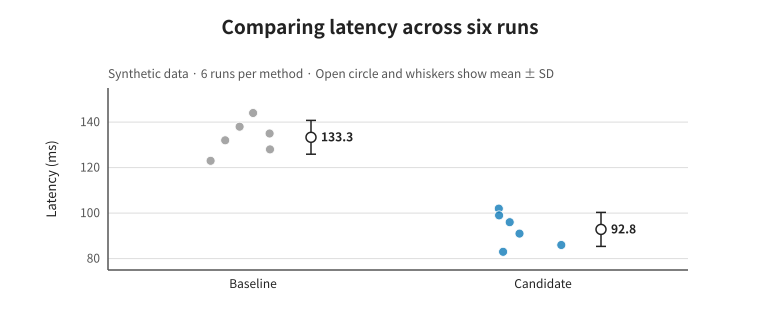

# zukai · 図解

**An Agent Skill for drawing and checking SVG diagrams and charts.** Use it to explain a workflow, show how a system fits together, or make the results of an experiment easier to read in a report, tutorial, or slide.



Decide how the figure will be used, draw it as SVG, check legibility at the intended width, then give readers a caption that tells them what to look at.

## Install

In your project directory, run the [skills CLI](https://github.com/vercel-labs/skills) and select your agent:

```sh
npx skills add yayuyosakana/zukai --skill zukai
```

You can also clone the repository and place the whole [`skills/zukai`](skills/zukai) folder in a skills directory your agent discovers. The scripts use Python 3.10+ and the standard library. The Markdown checker uses Git to find the repository root. PNG previews are optional and use Chrome, Chromium, or `rsvg-convert`.

## Try it

Ask your agent to use zukai and tell it where the figure will appear:

> Use zukai to add a diagram of the input → processing → evaluation flow to this README. Use the actual code to name each stage. Check the SVG at 720 px and add a caption.

> Use zukai to compare the two runs in `results.csv`. Show the observations for each condition, include the units, and label the summary interval.

> zukai を使って、この実験レポートに「何をしたか」の流れ図と「何が分かったか」の結果図を入れて。各図の下に、どこを見ればいいか一文で書いて。

## Example: compare repeated measurements



Each colored dot is one synthetic timing run. The open circles and whiskers show means and one sample standard deviation on each side. The candidate measurements cluster at lower latencies in these example data.

### What gets checked

| At this step | What zukai looks for |
|---|---|
| Save a figure | Text that extends past its box, overlaps nearby labels, or falls outside the canvas |
| Check the SVG | Text size at its intended display width, contrast, line and text collisions, hard to distinguish series, and invalid SVG references |
| Check the Markdown | Missing local images, paths outside the repository, and missing captions |

These checks use approximate text bounds. Preview the figure if you need to confirm a particular font or layout. For uncertainty plots, compute intervals using your analysis and pass the endpoints and interval type to the drawing script.

## Run the examples without an agent

From a clone of this repository:

```sh
python3 examples/make_examples.py
python3 skills/zukai/scripts/check_svg.py examples/*.svg
python3 skills/zukai/scripts/check_md.py README.md
```

The [example script](examples/make_examples.py) shows how to draw boxes and arrows, then plot individual observations and a summary interval. For more figure types, see the [chart and diagram guide](skills/zukai/references/patterns.md). Agent instructions are in [SKILL.md](skills/zukai/SKILL.md).

## License

[MIT](LICENSE)
